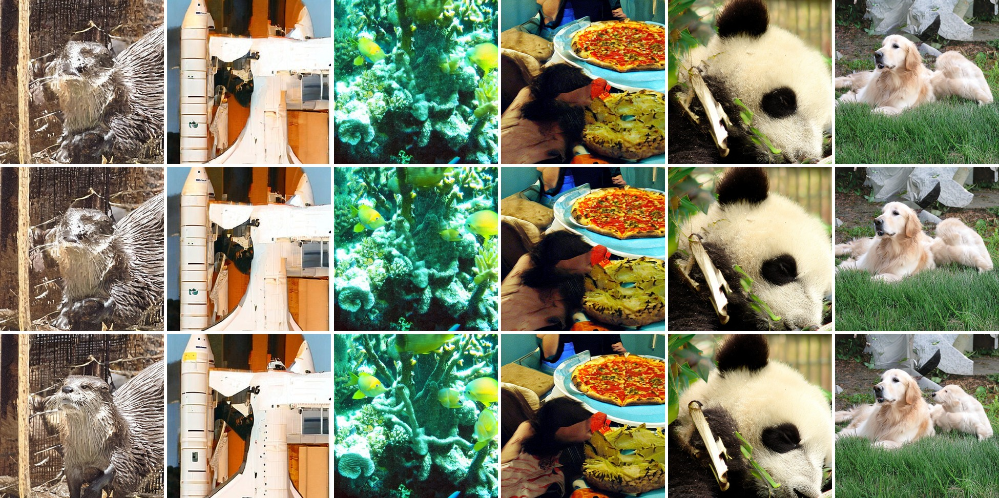
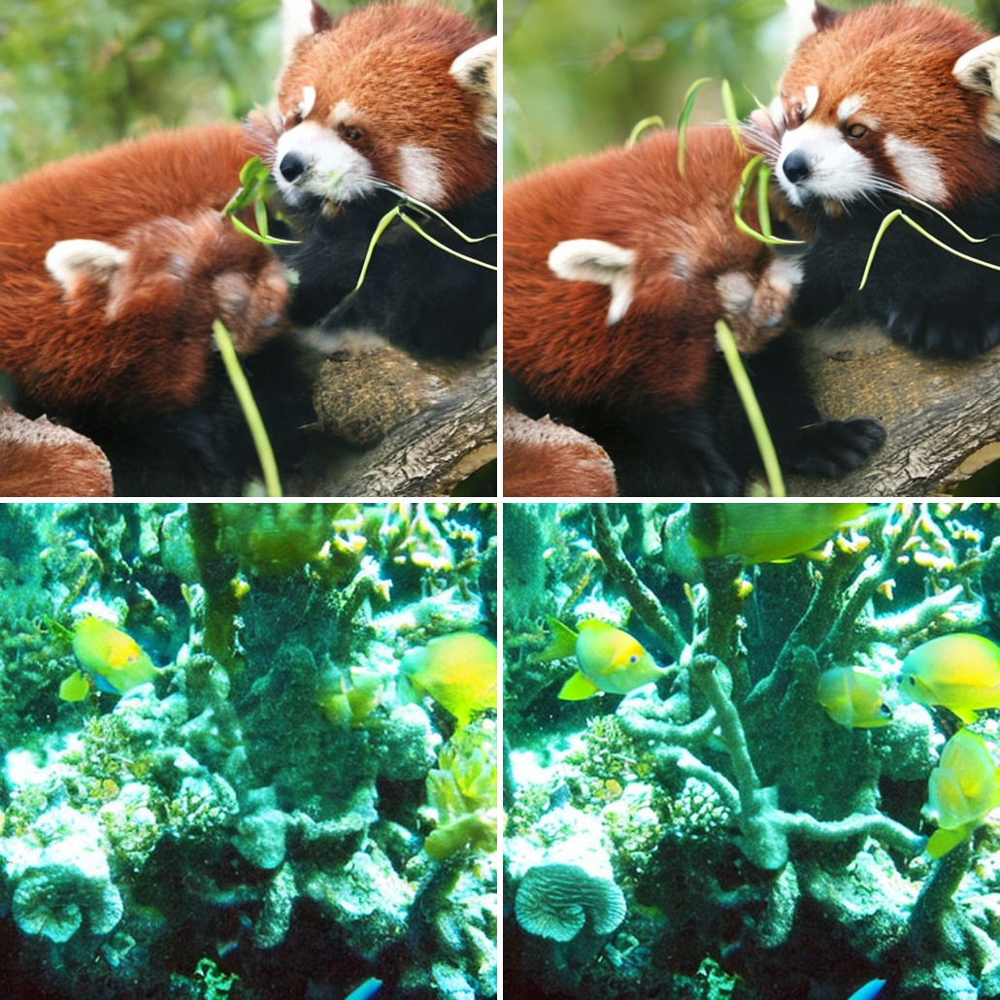
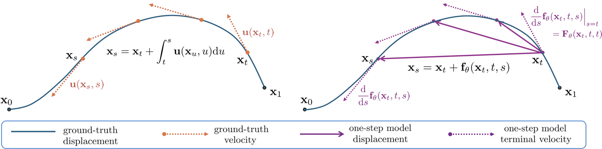

<h1 align="center">TVM on Lucid</h1>

<p align="center">
  <b>One-step 512×512 ImageNet generation, natively on Apple Silicon.</b><br>
  A torch-free re-implementation of <a href="https://arxiv.org/abs/2511.19797">Terminal Velocity Matching</a>
  on <a href="https://github.com/lucid-official/lucid">Lucid</a>. The released 678M checkpoints run unchanged on
  Metal, verified against the reference implementation to 1.4e-5.
</p>

<p align="center">
  <a href="https://arxiv.org/abs/2511.19797"></a>
  <a href="https://github.com/lumalabs/tvm"></a>
  <a href="https://huggingface.co/lumaai/tvm"></a>
  <a href="https://pypi.org/project/lucid-dl/3.15.5/"></a>
  
  
  <a href="LICENSE"></a>
</p>

<p align="center">
  
</p>

<p align="center">
  <sub>The released ImageNet-512 checkpoint (<code>im512_w2p5</code>, <i>w</i> = 2.5) at <b>one network evaluation
  per image</b>, 512×512, on a Mac Studio M4 Max. The classes were picked by hand; the samples were not: seed 0,
  first draw for each class. Generated with <code>lucid.compile</code>: 112 ms per image for the network, 216 ms for
  the VAE.</sub>
</p>

---

## Highlights

- **The authors' weights, unchanged.** All three released checkpoints map one-to-one onto this port's network. The
  512² one runs here with outputs within **1.4e-5** of the reference implementation.
- **No pickle is ever executed.** The release ships EDM-style pickles that `exec` embedded source code when loaded.
  A restricted reader turns them into SafeTensors without running anything and without torch.
- **One step, 512², 0.28 s end to end.** Exported through `lucid.coreml`, the 678M network generates an image in
  102 ms and the VAE decodes it in 181 ms. `lucid.compile` gives 1.63× on the network at fp32 with no visible
  change: 84 dB PSNR against eager.
- **Written as a Lucid user would write it.** The network, the objective with the Jacobian-vector product it
  back-propagates through, and the sampler use only Lucid's public API, and a test enforces it.

## News

- **2026-10-25** — The released ImageNet checkpoints run on Lucid, with a pickle-free converter, an SD-VAE decoder,
  and Metal, `lucid.compile` and Core ML backends. See [Results](#results) and [Speed](#speed-on-an-m4-max).

## What this is

Terminal Velocity Matching (Zhou, Parger, Haque & Song, ICLR 2026) trains one network to jump between any two
times of a flow, so a single evaluation goes from noise to data. See
[the method in brief](#terminal-velocity-matching-in-brief). This repository contains:

- **The method, written as a library user would write it.** The network, the objective, the time sampler, both EMAs
  and the sampler use only `lucid`, `lucid.nn`, `lucid.nn.functional`, `lucid.linalg`, `lucid.special` and
  `lucid.optim`. Nothing comes from Lucid's private modules or its model zoo, and
  [`tests/test_public_api.py`](tests/test_public_api.py) enforces this.
- **The released ImageNet models.** A converter for the upstream checkpoints, the SD-VAE decoder they need, and a
  sampler that runs on eager Metal, `lucid.compile` or Core ML.

## Results

### ImageNet 512×512 from the released checkpoint

The authors released three checkpoints ([`lumaai/tvm`](https://huggingface.co/lumaai/tvm)). All three are
DiT-XL/2 with 18 heads (678,068,496 parameters) over the latents of `stabilityai/sd-vae-ft-ema`:

| checkpoint | resolution | latents | guidance *w* | `do_scale_param` | FID-50k, as reported upstream |
|---|---|---|---:|:---:|---|
| `im256_w2` | 256² | 32×32×4 | 2.0 | ✓ | 3.29 at 1 NFE |
| `im256_w1p75` | 256² | 32×32×4 | 1.75 | ✓ | 1.99 at 4 NFE |
| **`im512_w2p5`** | **512²** | **64×64×4** | **2.5** | ✗ | **4.32 at 1 NFE** |

512² is the largest resolution released, and it is the checkpoint run here. The FIDs are the authors'. This
repository samples the models and does not re-measure them.

### One network, any number of steps

The same network serves every step count: `steps` even jumps from *t* = 1 to *t* = 0. More steps keep
the composition and sharpen what the single jump blurred, such as the otter's face, the shuttle's markings and the
reef fish.

<p align="center">
  <br>
  <sub>Rows: 1, 2 and 4 NFE, from the same noise. Otter, space shuttle, coral reef, pizza, giant panda, golden
  retriever.</sub>
</p>

### At full resolution

<p align="center">
  <br>
  <sub>Native 512×512 crops, not resized. Left: 1 NFE. Right: 4 NFE. Red panda, coral reef.</sub>
</p>

## Terminal Velocity Matching in brief

Flow matching interpolates data $`x_0`$ and noise $`x_1`$ as $`x_t = (1-t)\,x_0 + t\,x_1`$ and learns the velocity
field $`u(x_t, t)`$. Sampling then integrates that field over many small steps. The **flow map** makes the whole
jump at once:

```math
\psi(x_t, t, s) = x_t + \int_t^s u(x_r, r)\, dr .
```

TVM learns this jump with one network conditioned on both times, $`f_\theta(x_t, t, s) = (s - t)\,F_\theta(x_t, t, s)`$,
so that $`x_s \approx x_t + f_\theta(x_t, t, s)`$. At $`s = t`$ the same network is the ordinary velocity,
$`u_\theta(x_t, t) = F_\theta(x_t, t, t)`$.

Integrating the trajectory during training would be far too expensive. TVM instead differentiates with respect to
the **terminal** time. The derivative of the true jump with respect to where it lands must equal the velocity at the
landing point:

```math
\frac{d}{ds} f(x_t, t, s) = u\big(\psi(x_t, t, s),\, s\big).
```

With the network standing in for the unknown $`u`$ and $`\psi`$, the per-time objective matches the model's terminal
velocity, and learns the velocity itself by flow matching:

```math
\mathcal{L}^{t,s}_{\mathrm{TVM}}(\theta) = \mathbb{E}\Big[\big\lVert \tfrac{d}{ds} f_\theta(x_t, t, s) - u_\theta\big(x_t + f_\theta(x_t, t, s),\, s\big) \big\rVert_2^2 + \big\lVert u_\theta(x_s, s) - (x_1 - x_0) \big\rVert_2^2 \Big].
```

At $`s = t`$ the first term reduces to the second, so flow matching is the zero-displacement case. In practice the
target on the right is read from an EMA of the weights under a stop-gradient. The gradient flows through the
Jacobian-vector product $`\partial_s F_\theta`$.

**Why one step can be enough.** If $`u_\theta(\cdot, s)`$ is Lipschitz, a weighted integral of this objective bounds
the 2-Wasserstein distance between the data and the one-step model distribution (Theorem 1):

```math
W_2^2\big(f^{\theta}_{t \to 0}\,\#\,p_t,\ p_0\big) \;\le\; \int_0^t \lambda[L](s)\, \mathcal{L}^{t,s}_{\mathrm{TVM}}(\theta)\, ds + C .
```

A standard DiT is not Lipschitz, so the released network RMS-normalises its tokens, its queries and keys, and its
adaLN modulations.

**Guidance and sampling.** The class-conditional network also takes the guidance weight $`w`$. It regresses the
guided velocity $`w\,(x_1 - x_0) + (1 - w)\,u_{\theta^*}(x_s, s, \varnothing)`$, with the loss weighted by $`1/w^2`$.
Sampling takes $`n`$ even jumps from $`t = 1`$ to $`t = 0`$ with $`x_s = x_t + (s - t)\,F_\theta(x_t, t, s, c, w)`$, and
$`n = 1`$ is one-step generation.

<p align="center">
  <br>
  <sub><b>Figure 2 of the paper.</b> Left: the ground-truth flow map integrates the velocity. Right: the model jumps
  from <i>x<sub>t</sub></i> to <i>x<sub>s</sub></i> in one step, trained so that its terminal velocity matches the
  velocity where it lands. From Zhou et al., <a href="https://arxiv.org/abs/2511.19797">arXiv:2511.19797</a>,
  <a href="https://creativecommons.org/licenses/by/4.0/">CC BY 4.0</a>; rendered from the arXiv source PDF and
  resized.</sub>
</p>

## Speed on an M4 Max

Measured by [`scripts/sample_released.py`](scripts/sample_released.py) on a Mac Studio M4 Max (32-core GPU,
36 GB), with a working checkout of Lucid `main` at `7e47e33` and macOS 27.0. The run takes 16 images at 512².
The network runs 8 images per call (Core ML: 1) and the VAE one image per call. Every backend gets the same noise, and an untimed batch of
the timed shape runs first.

| backend | precision | network, 1 NFE | VAE decode | end to end, 1 NFE | images/s at 1 · 2 · 4 NFE | agreement with eager |
|---|---|---:|---:|---:|---|---|
| Metal, eager | fp32 | 183 ms | 237 ms | 420 ms | 2.38 · 1.65 · 1.03 | — |
| `lucid.compile` | fp32 | **112 ms** (1.63×) | 216 ms | 328 ms | 3.05 · 2.27 · 1.50 | 84 dB PSNR |
| `lucid.coreml`, GPU | fp16 | **102 ms** (1.79×) | **181 ms** | **284 ms** | **3.53 · 2.59 · 1.70** | 56 dB PSNR (45 dB at 4 NFE) |

<p align="center">
  <br>
  <sub>The same noise and class at 1 NFE. Eager, <code>lucid.compile</code>, Core ML fp16, then
  |compile − eager| and |Core ML − eager|, both ×20. Compile differs by at most 1 level of 255; fp16 by at most
  14, along edges.</sub>
</p>

**Batch size.** `lucid.compile` caches one MPSGraph executable per input signature. Its first call traces in about
1.6 s.

| network batch | eager | `lucid.compile` | speedup |
|---:|---:|---:|---:|
| 1 | 175 ms | 121 ms | 1.45× |
| 4 | 182 ms / image | 111 ms / image | 1.63× |
| 8 | 184 ms / image | 112 ms / image | 1.65× |

**The Neural Engine is the wrong target for these networks.** Core ML places most of their operations on the ANE
when asked to, and it is slower and less exact there:

| fp16, batch 1 | GPU | Neural Engine | `ALL` (Core ML chooses) |
|---|---|---|---|
| two DiT-XL blocks, 1024 tokens | **7.9 ms**, 8.7e-4 rel. | 19.8 ms (84% of ops on ANE), 8.6e-3 rel. | 12.0 ms, chose the GPU |
| VAE decoder, 512² | **181 ms**, 6.3e-3 abs. | 922 ms (94% of ops on ANE), 0.16 abs. | — |

What this settles:

- **Core ML on the GPU is the fastest path at batch 1**, and fp16 costs nothing visible: 56 dB at 1 NFE. Its error
  compounds over steps, down to 45 dB at 4 NFE.
- **`lucid.compile` is the fast fp32 path**, with no change in output and no export step. Its gain grows with batch
  size and levels off from batch 4.
- **At 512², the VAE costs more than the generator.** On every backend one decode (181–237 ms) takes longer than one
  network evaluation (102–183 ms). A one-step model at this resolution is decoder-bound.

Two costs to plan for:

- **Exporting the generator** takes 5.4 s and peaks at 18 GiB of host memory at batch 1, for a 1.3 GB package. At
  batch 4 it ran a 36 GB Mac out of memory and swap.
- **Eager VAE decoding** of more than one 512² image per call pushes Metal into swap: 714 ms per image at batch 4,
  against 218 ms compiled. The sampler decodes one image per call.

## Numerical parity

Against the reference implementations, given the same weights:

| check | against | result |
|---|---|---:|
| `TVMNet`, **`im512_w2p5` weights**, fp32 on Metal | upstream `DiT_XL_2_18h`, fp32 | 1.4e-5 rel. (5.9e-5 abs.) |
| `TVMNet`, random DiT-S/2 weights, both parameterisations, CPU and Metal | upstream `DiT` | ≤ 2.6e-6 rel. |
| SD-VAE decoder, `sd-vae-ft-ema` | diffusers `AutoencoderKL`, fp32 | 5.7e-5 max, 2.5e-6 mean |
| converter | a pickle written by upstream's own `persistence` module | bit-identical, 164 / 164 tensors |
| positional table this port rebuilds | the table stored in the release | < 1e-5, checked on every load |

The network checks include conditional and null labels and per-sample guidance weights. Upstream ran inference
under bf16 autocast. This port runs in fp32 (eager, compile) or fp16 (Core ML).

The method itself is checked against independent derivations:

| check | against | result |
|---|---|---:|
| `jvp_s` primal | `forward`, same weights | 8.9e-15 |
| $`\partial_s F_\theta`$ | central finite difference in $`s`$ | 5.4e-9 (outputs O(1)) |
| $`\partial_s F_\theta`$ | JVP by double backward | 2.7e-15 |
| $`\nabla_\theta \langle \partial_s F_\theta, R\rangle`$, all 42 tensors | double-backward reference | 1.5e-14 rel. |
| Eq. 15 loss / gradients | independent re-derivation, same random draws | 0.0 / 2.8e-15 rel. |
| `qk_norm`, `modulation_norm`, scaled param. off | finite difference in $`s`$ | ≤ 1.9e-8 |

These figures are float64 and were measured during development by running this exact source on CPU. Lucid
ships macOS wheels only, so that run used a stand-in that serves Lucid's API names from PyTorch, and the reference
values came from PyTorch's own double backward.

[`tests/test_tvm_method.py`](tests/test_tvm_method.py) re-checks the same properties on Lucid itself, on CPU and
Metal, with float32 tolerances. It also checks:

- the untrained field is exactly zero (adaLN-Zero);
- linear layers start at unit spectral norm;
- the block is invariant to the scale of its modulation (Eq. 16), and is not invariant without it;
- the scaled parameterisation multiplies by $`w`$;
- every time sampler keeps $`s \le t`$;
- the terminal term vanishes at $`s = t`$;
- both EMAs follow Algorithm 1 and stay out of `state_dict()`;
- the sampler takes the paper's even jumps (its Figure 3).

[`tests/test_pretrained.py`](tests/test_pretrained.py) pins the release's names onto this port's. On a Lucid
checkout that ships `lucid.models.generative.tvm`, `TestZooParity` loads the same weights into both implementations
and compares outputs, losses and gradients. The PyPI release skips it.

## Getting started

### Install

You need an Apple Silicon Mac on macOS 26 or later, and Python 3.14.

**Lucid's `main` (recommended until the next release).** The PyPI release 3.15.5 handles Metal views in a Python
layer that `main` replaced with C++ strided views, and TVM ran about 4× slower on it. With a
built Lucid checkout, use that checkout's interpreter and run from this directory, with nothing installed:

```bash
git clone https://github.com/lucid-official/tvm-lucid && cd tvm-lucid
LUCID_PY=~/path/to/lucid/.venv/bin/python             # the checkout's own venv
uv pip install --python $LUCID_PY tqdm pillow matplotlib
$LUCID_PY -c "import lucid; print(lucid.__file__)"   # must point into the checkout
$LUCID_PY -m pytest -q                               # also runs the parity tests against Lucid's zoo TVM
```

Every command below then starts with `$LUCID_PY` in place of `python`.

**Lucid 3.15.5 from PyPI.**

```bash
uv venv --python 3.14 .venv && source .venv/bin/activate
uv pip install -e ".[test]"
python -m pytest -q
```

3.15.5 declares `mlx>=0.31` with no upper bound, but it is linked against mlx 0.32.3. mlx 0.32.4 changed
`mlx::core::array::set_data`, so on a fresh install Lucid fails to import. `pyproject.toml` therefore pins
`mlx==0.32.3`. 3.15.5 has every API the released-weights path uses (SafeTensors, `lucid.compile`,
`lucid.coreml`), but the timings above were measured on `main` only.

### Run the released weights

```bash
# the checkpoint, and the VAE it was trained with (2.7 GB + 0.3 GB)
curl -L -o im512_w2p5.pkl https://huggingface.co/lumaai/tvm/resolve/main/im512_w2p5.pkl
curl -L -o sd-vae-ft-ema.safetensors \
    https://huggingface.co/stabilityai/sd-vae-ft-ema/resolve/main/diffusion_pytorch_model.safetensors

# pickle → SafeTensors without unpickling: no torch, nothing in the file is executed
python -I scripts/convert_released.py im512_w2p5.pkl im512_w2p5.safetensors

# 16 classes at 1, 2 and 4 NFE on every backend; grids and timings.json in runs/released/
python scripts/sample_released.py --weights im512_w2p5.safetensors --vae sd-vae-ft-ema.safetensors \
    --backend eager compile coreml --nfe 1 2 4
```

`--classes` takes any ImageNet indices, `--w` another guidance weight, and `--release` one of the 256² checkpoints.
The Core ML packages are exported on first use into `~/.cache/tvm_lucid/coreml` and loaded from there afterwards.

From Python:

```python
import lucid
from tvm_lucid import pretrained, vae

release = pretrained.RELEASES["im512_w2p5"]
net = lucid.compile(pretrained.load("im512_w2p5.safetensors", release.config()))
decoder = vae.load("sd-vae-ft-ema.safetensors")

noise = lucid.randn(4, 4, 64, 64, device="metal")
labels = lucid.tensor([88, 207, 387, 980], device="metal")  # macaw, golden retriever, red panda, volcano
z = pretrained.sample(net, noise, labels, steps=1, guidance_scale=release.guidance_scale)
z = pretrained.to_vae_latents(z, release)
images = [vae.to_pixels(decoder(z[i : i + 1])) for i in range(4)]  # (1, 512, 512, 3) each, 0-255
```

## Repository layout

```
tvm_lucid/
  tvm/            the method: config.py, layers.py, network.py, method.py
  pretrained.py   the released ImageNet checkpoints: configs, name mapping, sampler, latent statistics
  vae.py          SD-VAE decoder for the released latents
scripts/
  convert_released.py   release pickle → SafeTensors, without unpickling
  sample_released.py    released weights: grids and timings on eager / compile / Core ML
assets/           README figures
```

## Limitations

- **The released models are sampled, not evaluated.** No FID-50k is computed here. The table quotes the authors'
  numbers, which were measured under bf16 autocast on their hardware.
- **Only `im512_w2p5` has been run.** The 256² checkpoints are configured (`--release im256_w2`, `im256_w1p75`)
  and go through the same converter and name mapping, but neither has been downloaded and sampled here.
- **Core ML at batch 1.** Exporting the 678M network peaks at 18 GiB of host memory at batch 1 and exhausted a
  36 GB Mac at batch 4. Larger batches need more memory than this machine has.

## Citation

```bibtex
@article{zhou2025terminal,
  title={Terminal Velocity Matching},
  author={Zhou, Linqi and Parger, Mathias and Haque, Ayaan and Song, Jiaming},
  journal={arXiv preprint arXiv:2511.19797},
  year={2025}
}
```

## Acknowledgements

- [Terminal Velocity Matching](https://github.com/lumalabs/tvm), for the method, the released code that settles
  the details the paper leaves open, and the [released checkpoints](https://huggingface.co/lumaai/tvm).
- [DiT](https://github.com/facebookresearch/DiT), for the backbone it modifies.
- [`stabilityai/sd-vae-ft-ema`](https://huggingface.co/stabilityai/sd-vae-ft-ema), for the autoencoder the
  ImageNet models generate in.
- [Lucid](https://github.com/lucid-official/lucid), for the Apple Silicon runtime.

No model weights are redistributed here; the checkpoints are downloaded by the user. The samples in
[`assets/`](assets/) were generated by the released `im512_w2p5` checkpoint with this code.

## License

Code is MIT.
